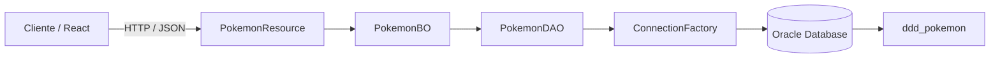

<div align="center">

# Pokémon CRUD

API REST para cadastro e gerenciamento de Pokémon capturados, com CRUD completo, validação de dados e persistência em Oracle, construída em camadas com Java e Spring Boot.

[](https://openjdk.org/)
[](https://spring.io/projects/spring-boot)
[](https://maven.apache.org/)
[](https://www.oracle.com/database/)
[](https://www.docker.com/)
[](https://render.com/)

### [API online](https://pokemon-java-2cnj.onrender.com/pokemon) · [Repositório](https://github.com/EnzoNukui/pokemon-java)

</div>

---

## Status

O projeto está funcional e disponível online. Novas melhorias podem ser adicionadas conforme a evolução da aplicação.

**API:** https://pokemon-java-2cnj.onrender.com/pokemon

## Sobre o projeto

O **Pokémon CRUD** é uma API REST que permite registrar Pokémon capturados e manter esse cadastro atualizado. Cada registro guarda **código, nome, altura, peso, categoria e data da captura**, e a API oferece as quatro operações básicas de um CRUD: criar, consultar, atualizar e remover.

O projeto foi desenvolvido no curso de Análise e Desenvolvimento de Sistemas da FIAP e reúne, em uma única aplicação, os fundamentos de uma API Java: **separação em camadas, acesso a banco com JDBC, validação de entrada, uso correto dos status HTTP, configuração por variáveis de ambiente e deploy em container**.

A pasta `front/` contém uma aplicação em React que consome a API, mas o foco deste repositório é o back-end.

---

## Funcionalidades

- CRUD completo na rota `/pokemon`: **listar**, **buscar por código**, **cadastrar**, **atualizar** e **remover**.
- Arquitetura em camadas: **Resource**, **BO**, **DAO** e **TO**.
- Acesso ao banco **Oracle** com **JDBC** e `PreparedStatement`, sem concatenação de SQL.
- Validação dos dados de entrada com **Bean Validation**.
- Respostas com status HTTP coerentes: `200`, `201`, `204`, `400` e `404`.
- Credenciais do banco lidas de **variáveis de ambiente**.
- Filtro de **CORS** para permitir o consumo da API por aplicações web.
- `Dockerfile` com **Eclipse Temurin 21** para publicação em container.

---

## Como funciona

A requisição percorre as camadas da aplicação até chegar ao banco de dados:



### Resource

Camada que expõe a API REST. Recebe as requisições, valida o corpo com `@Valid` e devolve a resposta com o status HTTP adequado.

### BO

Camada de regras de negócio. Faz a ponte entre o `Resource` e o `DAO`, mantendo o acesso a dados isolado da camada web.

### DAO

Camada de persistência. Executa as consultas SQL com JDBC e converte o resultado do banco em objetos `PokemonTO`.

### TO

Objeto de transferência que carrega os dados entre as camadas e declara as regras de validação de cada campo.

### Banco de dados

O **Oracle Database** armazena os Pokémon na tabela `ddd_pokemon`. A conexão é aberta pela `ConnectionFactory`, que lê `DB_URL`, `DB_USER` e `DB_PASSWORD` do ambiente.

---

## Tecnologias

### Back-end

- **Java 21**
- **Spring Boot 4.1**
- **Spring Web MVC**
- **Bean Validation**
- **JDBC**
- **Driver Oracle (ojdbc17)**

### Banco de dados

- **Oracle Database**
- SQL

### Build e deploy

- **Maven** (com Maven Wrapper)
- **Docker**
- **Render**

### Front-end (pasta `front/`)

- **React 19**
- **TypeScript**
- **Vite**
- **Tailwind CSS 4**

---

## Estrutura do repositório

```text
pokemon-java/
│
├── src/
│   ├── main/
│   │   ├── java/br/com/fiap/
│   │   │   ├── PokemonApplication.java
│   │   │   ├── resource/
│   │   │   │   ├── PokemonResource.java
│   │   │   │   └── CorsFilter.java
│   │   │   ├── bo/
│   │   │   │   └── PokemonBO.java
│   │   │   ├── dao/
│   │   │   │   ├── PokemonDAO.java
│   │   │   │   └── ConnectionFactory.java
│   │   │   └── to/
│   │   │       └── PokemonTO.java
│   │   └── resources/
│   │       └── application.properties
│   └── test/
│
├── front/
├── Dockerfile
├── mvnw
├── mvnw.cmd
└── pom.xml
```

### Principais arquivos

| Arquivo | Responsabilidade |
| --- | --- |
| `PokemonResource.java` | Endpoints REST, validação do corpo e status HTTP. |
| `PokemonBO.java` | Regras de negócio e ponte entre a API e o banco. |
| `PokemonDAO.java` | Consultas e comandos SQL com JDBC. |
| `ConnectionFactory.java` | Abertura e encerramento da conexão com o Oracle. |
| `PokemonTO.java` | Modelo de dados e regras de validação. |
| `CorsFilter.java` | Liberação de CORS para aplicações web. |
| `Dockerfile` | Build e execução da aplicação em container. |
| `pom.xml` | Dependências e configuração do Maven. |

---

## API

A API utiliza o prefixo `/pokemon`.

| Método | Endpoint | Descrição | Resposta |
| --- | --- | --- | --- |
| `GET` | `/pokemon` | Lista todos os Pokémon. | `200` |
| `GET` | `/pokemon/{codigo}` | Busca um Pokémon pelo código. | `200` ou `404` |
| `POST` | `/pokemon` | Cadastra um novo Pokémon. | `201` ou `400` |
| `PUT` | `/pokemon/{codigo}` | Atualiza os dados de um Pokémon. | `200` ou `400` |
| `DELETE` | `/pokemon/{codigo}` | Remove um Pokémon. | `204` ou `404` |

Exemplo de cadastro (`POST /pokemon`):

```json
{
  "nome": "Pikachu",
  "altura": 0.4,
  "peso": 6.0,
  "categoria": "Elétrico",
  "dataDaCaptura": "2026-11-01"
}
```

Exemplo de resposta (`GET /pokemon`):

```json
[
  {
    "codigo": 1,
    "nome": "Pikachu",
    "altura": 0.4,
    "peso": 6.0,
    "categoria": "Elétrico",
    "dataDaCaptura": "2026-11-01"
  }
]
```

---

## Executando localmente

### Pré-requisitos

Antes de começar, tenha instalado:

- JDK **21**
- Acesso a um **Oracle Database**
- Docker, caso queira executar pelo container

### 1. Clone o repositório

```bash
git clone https://github.com/EnzoNukui/pokemon-java.git
cd pokemon-java
```

### 2. Crie a tabela no banco

```sql
CREATE TABLE ddd_pokemon (
    codigo          NUMBER GENERATED ALWAYS AS IDENTITY PRIMARY KEY,
    nome            VARCHAR2(100) NOT NULL,
    altura          NUMBER(5,2)   NOT NULL,
    peso            NUMBER(6,2)   NOT NULL,
    categoria       VARCHAR2(50)  NOT NULL,
    data_da_captura DATE          NOT NULL
);
```

### 3. Configure as variáveis de ambiente

A aplicação lê a conexão diretamente do ambiente do sistema, sem arquivo `.env`.

Windows (PowerShell):

```powershell
$env:DB_URL="jdbc:oracle:thin:@//host:1521/servico"
$env:DB_USER="seu_usuario"
$env:DB_PASSWORD="sua_senha"
```

Linux/macOS:

```bash
export DB_URL="jdbc:oracle:thin:@//host:1521/servico"
export DB_USER="seu_usuario"
export DB_PASSWORD="sua_senha"
```

> Se alguma dessas variáveis não estiver definida, a aplicação não consegue abrir a conexão com o banco.

### 4. Inicie a API

Linux/macOS:

```bash
./mvnw spring-boot:run
```

Windows:

```bash
mvnw.cmd spring-boot:run
```

A API ficará disponível em:

```text
http://localhost:8080/pokemon
```

### Executando com Docker

```bash
docker build -t pokemon-api .
docker run -p 8080:8080 \
  -e DB_URL="jdbc:oracle:thin:@//host:1521/servico" \
  -e DB_USER="seu_usuario" \
  -e DB_PASSWORD="sua_senha" \
  pokemon-api
```

### Comandos úteis

| Comando | Finalidade |
| --- | --- |
| `./mvnw spring-boot:run` | Inicia a aplicação em modo de desenvolvimento. |
| `./mvnw test` | Executa os testes. |
| `./mvnw clean package` | Gera o `.jar` na pasta `target/`. |
| `java -jar target/pokemon-0.0.1-SNAPSHOT.jar` | Executa o `.jar` gerado. |

---

## Regras de validação

Os dados enviados nas operações de cadastro e atualização são validados antes de chegar ao banco:

1. `nome` e `categoria` são obrigatórios.
2. `altura` e `peso` são obrigatórios e precisam ser maiores que zero.
3. `dataDaCaptura` não pode estar no futuro.

Quando alguma regra não é atendida, a API responde com `400` e o registro não é salvo.

---

## Principais aprendizados

O desenvolvimento deste projeto envolveu diferentes etapas de uma API back-end e permitiu trabalhar com:

- desenvolvimento de uma **API REST** com Spring Boot;
- organização do código em **camadas** (Resource, BO, DAO e TO);
- acesso a banco de dados com **JDBC** e `PreparedStatement`;
- integração e persistência com **Oracle Database**;
- validação de entrada com **Bean Validation**;
- uso adequado de **status HTTP**;
- configuração de **CORS**;
- uso de variáveis de ambiente para dados sensíveis;
- empacotamento com **Maven** e execução em **Docker**;
- deploy de uma API Java em nuvem.

---

## Autor

Desenvolvido por **Enzo Nukui**.

- GitHub: [@EnzoNukui](https://github.com/EnzoNukui)
- LinkedIn: [linkedin.com/in/enzo-nukui](https://www.linkedin.com/in/enzo-nukui/)

---

<div align="center">

Projeto desenvolvido para aplicar, em uma única solução, conceitos de **API REST, arquitetura em camadas, JDBC, banco de dados, validação e deploy**.

</div>
